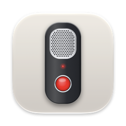
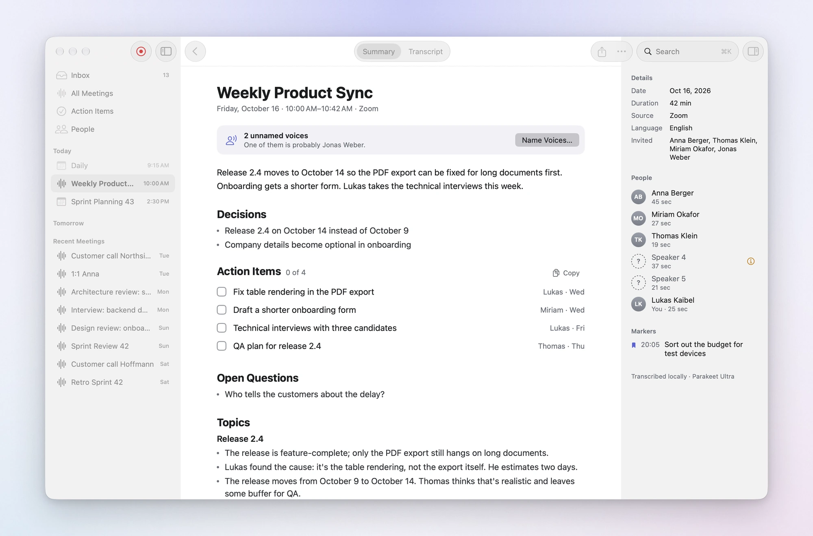
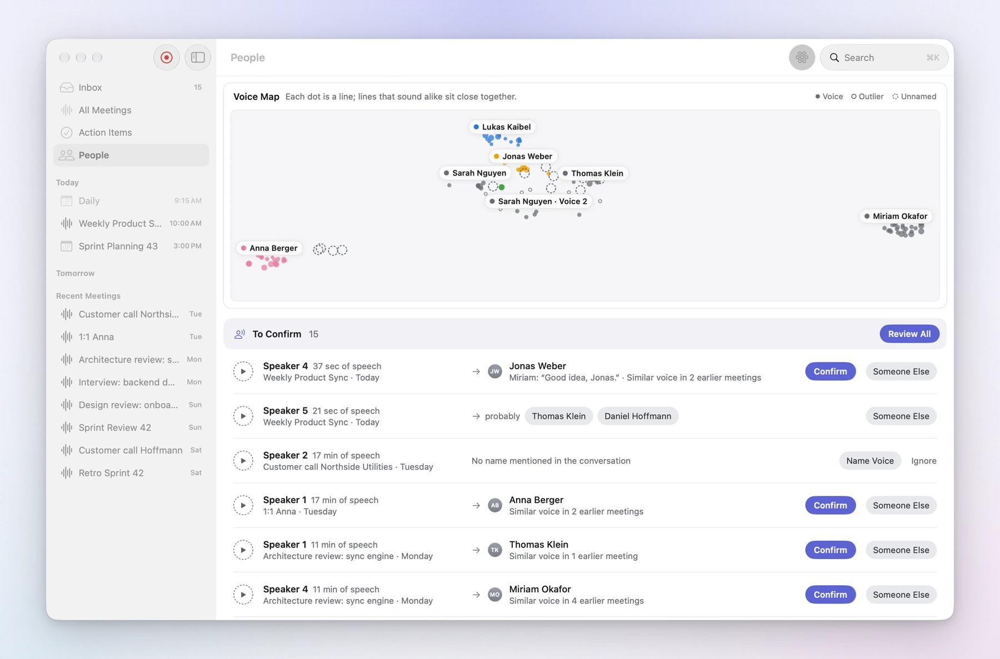
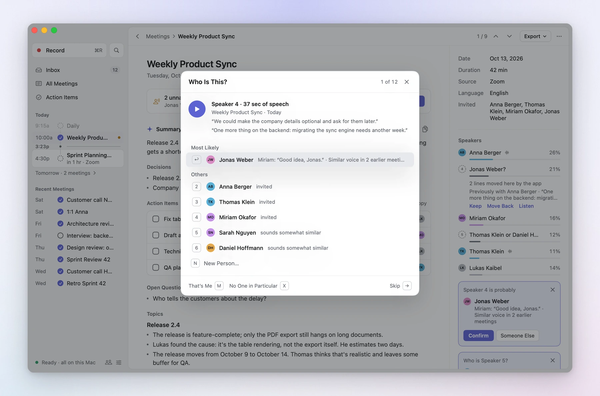
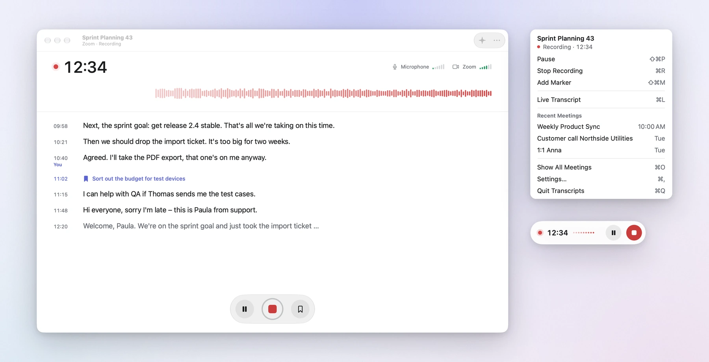
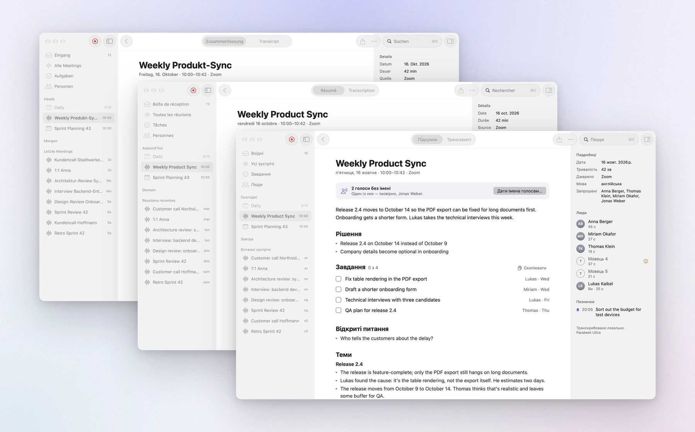

<p align="center">
  <picture>
    <source media="(prefers-color-scheme: dark)" srcset="Design/icon-dark.png">
    
  </picture>
</p>

<h1 align="center">Transcripts</h1>

<p align="center">
  <b>A native app for Mac, iPhone and iPad that transcribes your meetings on the device itself and learns who is
  speaking.</b><br>
  A live transcript while you talk, the names of the people on the call or around the table, and a summary afterwards
  if you want one.
</p>

<p align="center">
  
  
  
  
  
  <a href="LICENSE"></a>
  <a href="CHANGELOG.md"></a>
</p>

<p align="center">
  <a href="https://lukaskaibel.github.io/transcripts-app/"><b>Website</b></a> &nbsp;·&nbsp;
  <a href="#a-quick-tour"><b>Tour</b></a> &nbsp;·&nbsp;
  <a href="#iphone-and-ipad"><b>iPhone and iPad</b></a> &nbsp;·&nbsp;
  <a href="#how-the-names-come-about"><b>How names work</b></a> &nbsp;·&nbsp;
  <a href="#languages"><b>Languages</b></a> &nbsp;·&nbsp;
  <a href="#getting-started"><b>Getting started</b></a> &nbsp;·&nbsp;
  <a href="#keyboard"><b>Shortcuts</b></a> &nbsp;·&nbsp;
  <a href="CHANGELOG.md"><b>Changelog</b></a>
</p>

<br>

<picture>
  <source media="(prefers-color-scheme: dark)" srcset="Design/screenshots/meeting-dark.webp">
  
</picture>

> **Status: early.** Version 0.1.0 records, transcribes, names and summarises meetings every day on the maintainer's
> Mac. The iPhone and iPad app is new and has been tested in the simulator so far. There are no downloadable builds
> yet; you build it from source (a few minutes, see below).

## Why

Meeting assistants usually join your call as a bot or upload the recording to a server. This one does neither. It
records the call and your microphone on your Mac, transcribes both there, and learns the voices of the people you
talk to, so the transcript says who said what. Audio, transcripts and voices never leave your devices (and, if you turn
on sync, your own private iCloud); only the transcript text goes to the summary service you choose, and with a local
model not even that.

## A quick tour

### A meeting, finished when it ends

About half a minute after a call, the meeting is transcribed again in a careful second pass, the voices are told apart
and named, and the summary is written: a short overview, the decisions, action items with owner and due day, open
questions, and below them every topic of the meeting with what was said about it. Each part copies with one click, the
action items as a checklist, ready to paste into a chat, a ticket or a note. *Summary* and *Transcript* in the toolbar
switch between the two; play any line, set markers while recording, export as Markdown, or search every transcript
with ⌘K.

The window is built like the Mac's own apps: a sidebar with today's calendar meetings and recordings, tomorrow's folded
away and the latest meetings below; the meeting as a page; and its details and people in the inspector on the right
(⌃⌘I). The inbox collects what a meeting leaves behind: a new summary and voices without a name.

### It learns the voices

Confirm a voice once and the app recognises that person in every later meeting. The People screen lists the voices
waiting for a name, and the voice map shows all of them at once: every line is a dot, lines that sound alike sit
close together. You see at a glance which voices the app could mix up, whose voice falls into two groups (another
microphone), and which lines fit nobody.

<picture>
  <source media="(prefers-color-scheme: dark)" srcset="Design/screenshots/people-dark.webp">
  
</picture>

### "Is this Jonas?"

After a meeting a quiet bar above the summary says how many voices have no name yet. *Name Voices…* asks about them
one at a time, the way Photos asks about a face: a sample plays, with what the voice said, and the app says whom it
thinks it is. *Yes* settles it (or Return); *Someone Else* lists the other guesses, the invitees and everyone known, a
new name, you, or nobody in particular. To fix a single passage, click the speaker's name in the transcript: the menu
names the voice, or with *Only This Passage* gives just those lines to someone else.

<picture>
  <source media="(prefers-color-scheme: dark)" srcset="Design/screenshots/naming-dark.webp">
  
</picture>

### While you record

A menu bar item and a small glass recorder you can put anywhere, with the time, the sound coming in, pause and stop;
point at it for the last words it heard. Neither names anyone: who is talking is settled after the meeting, from the
whole recording. The live window shows the transcript as it is spoken, your own lines marked, a live summary if you
like, and markers.

<picture>
  <source media="(prefers-color-scheme: dark)" srcset="Design/screenshots/recording-dark.webp">
  
</picture>

### In your language

The interface speaks English, German, French, Spanish, Italian, Portuguese, Dutch, Polish, Russian and Ukrainian:
the languages its speech recognition transcribes best. It follows macOS, or the language you pick in Settings.



## iPhone and iPad

The same app on iPhone and iPad, for the meetings around a table: put the phone in the middle, tap *Record* and lock
the screen. It records the room through the built-in microphone, writes a live transcript, tells the voices apart
afterwards and names the ones it knows, just like the Mac. Speech recognition, voice recognition and the archive stay on
the device; only the transcript text goes to the summary service you choose.

- **Record from anywhere.** On the iPhone, *Record* sits above the tab bar on every screen. While it records, that bar
  shows the time, the level, pause and stop; a tap opens the live transcript with the time, the sound of the last
  seconds and buttons to mark a moment, stop and pause in reach of the thumb. On the iPad the record button sits at the top of the sidebar,
  as on the Mac. A phone call pauses the recording, and it carries on when the call ends.
- **The same screens.** Inbox, Meetings (today as a day plan with a line for now, then every meeting by day), Action
  Items, People with the voice map, and Search through every transcript. A planned meeting offers to record it, with
  who's invited. A meeting has its summary, action items, speakers and transcript; play it back from any line.
- **iPad like the Mac.** A sidebar, the list with the meeting beside it, and the facts and the voices in a column on the
  right when there is room. The live window shows the live summary and the markers beside the transcript. With a
  keyboard: ⌘R records, ⇧⌘P pauses, ⇧⌘M marks, ⌘K searches, ⌘1–⌘4 switch, ⌘[ goes back.
- **On the Lock Screen and in the Dynamic Island.** A running recording shows its title, a clock and the markers there,
  with buttons to pause, mark a moment and stop without opening the app. *Record a Meeting* starts one from Control
  Center, the Lock Screen, the Action Button, Siri or Shortcuts.
- **Finished in the background.** After the recording the meeting is processed on the device; iOS 26 lets that go on
  with the screen locked and shows its progress.
- **Shared views.** *Name Voices*, the people, the summary and the settings are the Mac's own views, laid out for a
  narrow screen, so a change shows on every device. A meeting switches between *Summary* and *Transcript* under its
  title, and the recording screen has the time, the sound and the buttons at the bottom, as in Voice Memos. Settings ›
  App-Icon offers the dictaphone in silver, titanium, white and midnight for the Home Screen.

- **The same meetings everywhere.** With Settings › General › iCloud on, meetings, people and the voices the app
  learned are the same on your Mac, iPhone and iPad, and the recordings too if you like: record on the phone, read on the
  Mac, and a voice named on one device is known on the others. It goes through the private database of your iCloud
  account, which only your devices can read, works offline and catches up later. Off until you turn it on.

Summaries use Anthropic, OpenAI or Google (Ollama runs on the Mac only).

## What it does

- **Records the call and you separately.** Your microphone and everything the Mac plays (Zoom, Teams, Meet in the
  browser, …) are two tracks, taken with a Core Audio process tap. No virtual audio driver, and the app knows for
  certain which lines are yours.
- **Works with speakers, not just headphones.** After a meeting the call's echo is taken out of your microphone
  track, predicted from the call track itself, so playback has every voice once and your own lines stay complete.
- **Transcribes on the Mac.** NVIDIA's Parakeet model runs on the Neural Engine through
  [FluidAudio](https://github.com/FluidInference/FluidAudio): a live transcript while you talk, and a second, careful
  pass when the meeting ends. 25 European languages, also mixed in one meeting.
- **Tells the voices apart and learns them.** Every line gets its own voice fingerprint; a clear match with a known
  person is named automatically, a weaker one is suggested, and an unsure one reads "Hai or Julian?". Names from the
  conversation ("Thomas, does that work for you?", "this is Paula") and the calendar's invitees become suggestions you
  accept with one click.
- **Knows your calendar.** Meetings are named after the event and know who was invited. When a meeting starts you get
  a notification with a *Record* button. Calls without a calendar event are noticed too, and you're reminded to stop
  when the call is over. Events of shared calendars that you aren't invited to stay out, and *Not my meeting* hides
  any other series or a whole calendar.
- **Summarises, if you want.** An overview, decisions, action items, open questions and the topics in detail, from
  Anthropic, OpenAI, Google or a local model in Ollama, automatically after each meeting or on request, plus an
  optional live summary while recording. In the meeting's language or one you choose. API keys stay in the Keychain.
- **Copies what you need.** The whole summary as Markdown (⇧⌘C), one part of it, the action items as a checklist or a
  single task, to take into a chat, a ticket or a note.
- **Keeps an archive you can search.** Meetings grouped by day, full-text search through every transcript, playback
  from any line, Markdown export, and import of audio or video files (voice memos, Zoom recordings, a meeting recorded
  in a room).
- **Native.** Swift and SwiftUI, light and dark. The icon is a dictaphone, and Settings › App-Icon makes it yours:
  pick the body, the speaker grille, the record button and the background, or start from a preset, and the Dock shows
  your dictaphone while the app runs. Apple silicon only.

## How the names come about

1. **Two tracks.** Everything on the microphone track is you; the call track holds everyone else. With speakers
   instead of headphones the call comes back into the microphone; after the meeting that echo is taken out of your
   track, predicted from the call track itself (delay, room and level per frequency band). Echoes that still made it
   into the transcript are dropped.
2. **Separating voices.** The diarizer (pyannote community-1 with VBx clustering) splits the call track into voices.
   Its turns are then checked against the voices the app already knows, line by line: a voice that turns out to be two
   known people is split, and someone who introduces themselves by another name is someone else, however alike they
   sound.
3. **Recognising voices.** Every line of the transcript gets its own voice embedding (256 dimensions), and a person is
   all the lines assigned to them. Their lines are grouped by sound: the main group is their voice; a second big one is
   the same person sounding different (another microphone) or, if it sounds clearly unlike the first, perhaps someone
   else under their name, which the person's page points out. Small groups that fit nothing are strays (a cough,
   crosstalk, a line of someone else) and don't count. A clear match with one of a known person's voices is named
   automatically; a weaker one becomes a suggestion. How bold the app is can be set in Settings › Voices (*Cautious*,
   *Balanced*, *Generous*).
4. **Names from the conversation.** Introductions, people addressed by name, "thanks, Jonas" and the calendar's
   invitees become suggestions, in all ten interface languages, including names that change when someone is called by
   them (Polish "Anno" for Anna, Ukrainian "Олено" for Олена).
5. **Only what you confirm defines a voice.** Recognised lines may refine a voice you confirmed, so it can change over
   time, but never start one. After every confirmation or correction every voice you haven't settled is judged again,
   so a wrong name doesn't carry on: correct it once, and what followed from it follows the correction. A speaker whose
   lines sound like two voices shows both in the meeting; each can be played and given to someone on its own, which
   splits the speaker in the transcript.
6. **Lines in the wrong place move.** When some lines of one speaker sound as clearly like another known person as an
   automatic name needs, the app moves them there; the ⓘ next to the person in the meeting's inspector keeps them or
   moves them back. Moved lines count only as recognised speech, so a wrong move teaches nothing.
7. **Unsure is said out loud.** A voice that may be one of a few people keeps its label until you settle it: *Name
   Voices* asks about the likeliest and lists the others first under *Someone Else*, and the summary reads "Speaker 2
   (maybe Hai or Julian)", so nothing is lost and nothing is named wrongly.

During the recording the app doesn't name anyone: a guess made from a few seconds is wrong too often to show. The pass
after the meeting sees the whole recording and names the voices then.

## Languages

The app speaks only the languages that both halves of it handle well. Speech recognition decides: Parakeet v3 gets
fewer than 8 % of the words wrong in these ten on the FLEURS benchmark, and between 9 and 24 % in its fifteen other
languages. Recognising voices works on the sound of a voice, whatever the language.

| Language | Words wrong (FLEURS) | | Language | Words wrong (FLEURS) |
|---|---|---|---|---|
| Italian | 3.0 % | | French | 5.2 % |
| Spanish | 3.5 % | | Russian | 5.5 % |
| Portuguese | 4.8 % | | Ukrainian | 6.8 % |
| English | 4.9 % | | Polish | 7.3 % |
| German | 5.0 % | | Dutch | 7.5 % |

Everything follows the language: the interface with its plural forms and quotation marks, dates and numbers in your
region's format, the names spotted in the conversation, and the summary, which is written in the meeting's language or
the one you choose in Settings › AI. On a Mac set to another language the interface is in English; meetings in
Parakeet's fifteen other languages are still transcribed, just less reliably.

## Getting started

You need a Mac with Apple silicon, macOS 26 or later and Xcode 27. For iPhone and iPad: iOS or iPadOS 26 or later.

```bash
git clone https://github.com/lukaskaibel/transcripts-app.git
cd transcripts-app
open Transcripts.xcodeproj
```

1. Copy `Config/Local.xcconfig.example` to `Config/Local.xcconfig` and enter your Apple Developer team, so the app is
   signed with your certificate (macOS remembers permissions per signature).
2. Run the *Transcripts* scheme (⌘R in Xcode).
3. The first window walks you through the rest: your name, microphone, calendar and notifications. It also downloads
   the speech models once (about 700 MB, to `~/Library/Application Support/FluidAudio/Models`). macOS asks for
   *system audio recording* the first time you record.
4. For summaries, open Settings › AI and enter an API key, or point it at Ollama.
5. For iCloud sync between your devices, add `TR_ICLOUD = YES` to `Config/Local.xcconfig`. Xcode's automatic signing
   then adds iCloud (CloudKit) and push notifications to your App ID and creates the container `iCloud.<bundle id>`
   (on the command line: `xcodebuild -allowProvisioningUpdates`). Without it the app builds without iCloud and doesn't
   offer sync.

Tip: set the notification style for Transcripts to *Persistent* in System Settings › Notifications, so the "… is
starting. Start recording?" reminder stays until you click it.

On iPhone and iPad it's the same scheme: pick a simulator or your device as the destination in Xcode. The simulator
needs no team; a device needs the team in `Config/Local.xcconfig`. The first start asks for your name, the microphone,
the calendar and notifications, and downloads the speech models (about 700 MB, best on Wi‑Fi).

To try the app without touching your data, start it in demo mode: `-demo YES` as a launch argument (in the scheme, or
`open Transcripts.app --args -demo YES`). It runs on made-up meetings in memory, in English, or in German when the
interface is German. Add `-AppleLanguages "(fr)"` to see it in another language.

### Keyboard

| Keys | |
| --- | --- |
| ⌘R | Start or stop recording |
| ⇧⌘P | Pause or resume |
| ⇧⌘M | Add a marker |
| ⌘L | Live window |
| ⌘K | Search and commands |
| ⌘1 – ⌘4 | Inbox / All Meetings / Action Items / People |
| ⌘↑ / ⌘↓ | Previous / next meeting |
| ⌘F | Find in the transcript |
| Space | Play or pause the recording |
| ⌘I | Import an audio or video file |
| Return, Space, →, Esc | In *Name Voices*: yes, play the voice again, skip it, stop for now |
| ⌃⌘I | Show or hide a meeting's details and people |
| ⇧⌘C | Copy the meeting's summary |
| ⌘[ | On the iPad: back |

## Testing

```bash
cd Packages/TranscriptsKit && swift test
```

188 tests with Swift Testing: transcript assembly, voice grouping, profiles, the re-check after corrections and moving
misplaced lines, voice refinement, name evidence in all ten languages, the live line check, echo removal and the repair
of old call tracks (on synthetic speech), the summary providers (with mocked HTTP), the summary's copied text, the database, audio files and the
app's actions.

The iPhone and iPad app has UI tests that run on the demo data in the simulator, on an iPhone and an iPad of their own
(created on first use): every screen, recording and stopping, naming a voice, copying the action items, renaming,
checking off a task, the settings, the first start. Each step leaves a screenshot in `build/test-results/`.

```bash
Tools/test-ios.sh            # iPhone and iPad
Tools/test-ios.sh iphone     # one device; add a test, e.g. PhoneTests/testOnboarding
```

The pipeline also runs on the command line, on real audio:

```bash
cd Packages/TranscriptsKit && swift build && .build/debug/transcripts-cli models
```

`transcripts-cli` has `transcribe`, `diarize`, `live`, `process`, `record` (a whole recording, played from files faster
than real time), `confirm`, `summarize`, `voices` (everyone's voice groups, and each meeting's speakers with the groups
of their lines) and `maintain`; see the top of `Sources/transcripts-cli/main.swift`. `Tools/make-test-meeting.py` builds
German test meetings with known speakers and a `truth.json`.

Results on a MacBook Pro with M4 Pro and 24 GB, with synthetic test meetings (one natural German voice, shifted in pitch
per person, which makes the voices harder to tell apart than real people):

| Meeting | Voices found | Text with the right voice |
| --- | --- | --- |
| 5 people, 1.5 min | 5 for 5 | 100 % |
| 5 people, 30 min | 5 for 5 | 100 % |
| 6 people, poor call audio, one joins late, no known voices | 4 for 6 | 86 % |
| the same, after confirming the voices of the first meeting | 6 for 6 | 100 % (4 named automatically, 1 suggested from her introduction) |
| 5 people recorded in a room (one track), known voices | 5 for 5 | 99–100 % |

Speed: a 30-minute meeting is finished about 30 seconds after it ends (about 65 times real time, up to 1.3 GB of
memory). The live transcript keeps up with several times real time.

## For contributors

```
Transcripts/                  App target for Mac, iPhone and iPad: entry point, icons, the string catalogs, the Live
                              Activity and App Shortcuts
TranscriptsWidgets/           Widget extension (iPhone and iPad): the Live Activity's views, the Control Center control
Shared/                       Compiled into both: the Live Activity's attributes and the recording's intents
TranscriptsUITests/           UI tests of the iPhone and iPad app (Tools/test-ios.sh)
Packages/TranscriptsKit/      Everything else, as a Swift package
  Sources/TranscriptsKit/
    Audio/                    Microphone, system audio tap, echo removal, audio files
    Speech/                   Speech recognition, voice activity, diarization (FluidAudio)
    Recording/                The running recording and its live transcript
    Pipeline/                 Processing after a meeting: assembly, refinement, archiving
    Speakers/                 Voice profiles, name evidence, identification, re-checks, live line check
    Calendar/                 Calendar, reminders, call detection
    AI/                       Summary providers and prompts
    Model/  Store/            Records and the GRDB database with full-text search
    Sync/                     iCloud sync with CKSyncEngine: change tracking, records, conflicts
    App/                      App model, settings, demo data, the app icon in any colours
    UI/                       SwiftUI views every platform shares: the meeting, people, settings, live transcript
    UI/Mac/                   The Mac's windows: sidebar, menu bar, floating recorder, command palette
    UI/iOS/                   iPhone and iPad: tabs and the iPad's sidebar, the screens around the shared views
    Support/                  Paths, formatting, the languages the app speaks
    AppIconPasses/            The app icon's grey passes that Settings › App-Icon colours (Tools/AppIcon/make.sh)
  Sources/transcripts-cli/    The pipeline on the command line
  Tests/TranscriptsKitTests/
Packages/Vendor/FluidAudio/   FluidAudio, vendored (see below)
Config/                       Build settings, Info.plist, entitlements
Tools/                        App icons, test meetings, screenshots, README and website pictures, translations
Design/                       Icon, README pictures, social preview
Website/                      The website on GitHub Pages: home, privacy policy, terms, support, Impressum
```

The interface texts are written in German in the code and translated in `Transcripts/Localizable.xcstrings` (the
widget extension's in `TranscriptsWidgets/Localizable.xcstrings`, the Siri phrases in
`Transcripts/AppShortcuts.xcstrings`). After changing texts, `Tools/localization/extract.sh` brings the catalogs up to
date; `Tools/localization/catalog.py` lists
what a language lacks, takes translations in and checks placeholders and plural forms. The pictures in this README are
made by `Tools/readme-images.sh`: the app runs in demo mode, in light and dark, its windows are captured from the
screen (it needs Screen Recording permission for the terminal and an awake screen), `Tools/readme-images/build.py`
lays them out, `Tools/iphone-images.sh` takes the iPhone's screens in the simulator (`PictureTests`), and
`Tools/readme-images/website.py` makes the website's pictures from both, the iPhone in a drawn frame. See [CONTRIBUTING.md](CONTRIBUTING.md) for how to propose changes.

The app icon is drawn by `Tools/AppIcon/dictaphone.py`. After changing it, run the script below: it writes
`Transcripts/AppIcon.icon` and the presets' icons (`AppIcon-*.icon`, alternate icons on iPhone and iPad), renders, with
Icon Composer's `ictool`, the grey passes that Settings › App-Icon colours in any colours, and the pictures of the icon
(it needs Python 3 with NumPy and Pillow, and `brew install librsvg`):

```bash
Tools/AppIcon/make.sh
```

The [website](https://lukaskaibel.github.io/transcripts-app/) is plain HTML and CSS in `Website/`, without a build
step; `.github/workflows/website.yml` publishes it to GitHub Pages when it changes on `main`. To look at it locally:

```bash
python3 -m http.server --directory Website
```

Data lives in `~/Library/Application Support/Transcripts` (the database and the recordings, compressed to AAC after
processing; keep them forever, for 30 days, or not at all). API keys are in the Keychain. With iCloud sync on, a copy
is in the private database of the user's iCloud account, in the zone `Transcripts` of the container
`iCloud.<bundle id>`; `-demo YES -demo.sync <zone> -demo.data <folder>` tries sync out in a zone and folder of its own.

## Good to know

- The live window and the floating recorder name nobody; who said what is worked out after the meeting, from the whole
  recording, and the transcript shows it then.
- Without any known voices, two people who sound very much alike can end up as one voice. Confirming a few voices
  fixes that for later meetings.
- Local summaries need a model that fits into memory next to everything else. On a 24 GB Mac a 27B model is far too
  slow; a model of roughly 8 to 14B parameters is the sweet spot. The app turns off Ollama's "thinking" for summaries.
- Summaries default to Claude Opus 5.5. If a safety classifier declines a request, Anthropic re-runs it on a fallback
  model (the `server-side-fallback` beta), so a summary doesn't fail for that reason.

## Versions

The project follows [semantic versioning](https://semver.org). Every release is tagged (`v0.1.0`) and described in the
[changelog](CHANGELOG.md). Until 1.0, minor versions may change behaviour.

## Acknowledgements

Built with [FluidAudio](https://github.com/FluidInference/FluidAudio) (Apache 2.0), vendored in
`Packages/Vendor/FluidAudio` at the commit in `UPSTREAM_COMMIT`, without its NemoTextProcessing binary; its licences
for third-party parts are in `ThirdPartyLicenses`. It runs NVIDIA's Parakeet speech recognition and pyannote's and
WeSpeaker's voice models, downloaded from FluidAudio's Hugging Face repositories, where their licences are listed. The
database is [GRDB](https://github.com/groue/GRDB.swift) (MIT).

## License

[MIT](LICENSE) © Lukas Kaibel
